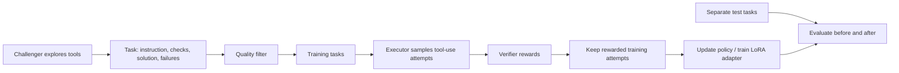

# Self-Challenging Language Model Agents

[](https://colab.research.google.com/github/Deep-Dhaduk/Self-Challenging-Language-Model-Agents/blob/main/notebooks/self_challenging_agents.ipynb)

An individual coursework implementation inspired by **[Self-Challenging Language Model Agents](https://arxiv.org/abs/2506.01716)**, Yifei Zhou, Sergey Levine, Jason Weston, Xian Li, and Sainbayar Sukhbaatar (2025).

This project demonstrates a task challenger, executable task verification, tool-using executors, and learning from successful attempts. Code lives in this repository; the notebook runs that same code on Google Colab. The video presentation will be prepared separately.

**Published Medium article:** [Can AI Agents Learn by Creating Their Own Challenges?](https://medium.com/@deepbharatbhai.dhaduk/can-ai-agents-learn-by-creating-their-own-challenges-dd7cdbf376e7)

**Presentation:** [PowerPoint](slides/self_challenging_agents.pptx) · [PDF](slides/self_challenging_agents.pdf) · [Speaker notes](slides/speaker_notes.txt) · [Slide overview](slides/slide_overview.png)

The 18-slide presentation includes editable diagrams and charts, embedded speaker notes, and source links. Its rehearsal plan totals approximately 16 minutes 20 seconds; verify the actual recording duration. Paper findings, the measured CPU demonstration, the unsuccessful first LLM attempt, and the pending retry are explicitly distinguished. The PDF is a visual edition without speaker notes or clickable links. The files have not been published to SlideShare.

## What is implemented

| Component | Implementation here |
| --- | --- |
| Tool environment | A resettable simulated shop with customer lookup, order lookup, cancellations, returns, and address changes. |
| Task specification | Instruction, verification checks, reference tool calls, and three failure cases. |
| Template challenger | Uses tool observations to construct known-valid fixtures. This is deterministic code, not an LLM. |
| LLM challenger | An optional language model explores the tools and authors all task components as JSON. Invalid proposals are rejected and logged. |
| Quality filtering | Check the reference solution succeeds, a no-op fails, and all three failure cases fail. |
| CPU executor | A categorical policy selects among five scripted strategies. Successful attempts update its probabilities. |
| LLM executor | A Hugging Face causal language model selects tool calls from observations, without seeing solutions or checks. |
| LLM learning | One iteration of response-only LoRA rejection fine-tuning (RFT) on rewarded self-generated training rollouts. |
| Evaluation | Before/after Pass@1, sampled Pass@k, per-operation success, tool errors, and verifier/oracle disagreements on separate test tasks. |
| Ablation | A controlled fixture experiment comparing three levels of task filtering. |
| Artifacts | Task JSONL, complete conversations, training examples, config, metrics, SVG charts, and an adapter when LLM training succeeds. |

The paper's Code-as-Task formulation motivates the task structure. Our verifier uses a constrained JSON specification interpreted by Python instead of executing arbitrary model-generated Python. The small shop, models, training procedure, and datasets are educational adaptations. **This is not a reproduction of the paper's M3ToolEval/TauBench benchmark results.** The paper's main method and experiments are described in [Sections 4–5](https://arxiv.org/html/2506.01716v1).



## Quick start: CPU demo

Python 3.10+ is required. The CPU demo uses only the standard library: no installation, model download, GPU, or API key is needed.

```bash
git clone https://github.com/Deep-Dhaduk/Self-Challenging-Language-Model-Agents.git
cd Self-Challenging-Language-Model-Agents
python -m sca demo --output outputs/demo
```

The default run creates 120 training tasks, samples four attempts per training task, updates the strategy policy, and evaluates on 60 held-out tasks with four attempts each. Open `outputs/demo/evaluation.svg` for the result and `outputs/demo/summary.json` for the full metrics.

The CPU policy learns which of five **hand-written strategies** receives a reward. It does not train a language model or discover new algorithms. Its results illustrate the learning loop only. The repository includes a measured [CPU example run](results/cpu_demo/README.md); scores there are ours, not the paper's.

Output directories must be new or empty. Use another `--output` value to keep earlier results intact.

## Google Colab: real LLM experiment

Open [the notebook](notebooks/self_challenging_agents.ipynb), or use the Colab badge after the notebook is pushed to GitHub. Run the initial CPU cells, select a CUDA GPU runtime for the LLM cells, and install the optional dependencies using the provided cell.

The notebook starts with real LLM execution/training on template-authored tasks. Set `TASK_SOURCE = "llm"` to enable the interactive LLM challenger. This distinction is recorded in every run. A small model may produce invalid tasks or no successful trajectories; these outcomes are recorded, never replaced with artificial successes.

The same experiment can be run from a terminal:

```bash
python -m pip install -e ".[llm]"
python -m sca llm --device cuda --task-source template --output outputs/llm_template
```

For LLM-authored tasks, a stronger model can be selected:

```bash
python -m sca llm --device cuda --task-source llm --model Qwen/Qwen2.5-1.5B-Instruct --train-tasks 12 --test-tasks 6 --rollouts 6 --train-steps 30 --output outputs/llm_challenger
```

The revised default is `Qwen/Qwen2.5-1.5B-Instruct`. Model downloads need internet access. No paid API service is used. CUDA loads use bfloat16 when supported, otherwise float16; CPU loads use float32. LoRA parameters remain float32, with gradient checkpointing during training. Sequences longer than `--max-length` are dropped from training, not silently cut through an answer. The revised pretrained-model configuration still needs a Colab run; selecting a stronger model does not establish an improvement.

The optional dependency versions are pinned to the locally checked Transformers/PEFT APIs. Training is a small PyTorch loop with AdamW, LoRA on query/value projections, and loss masked to assistant responses. No TRL server or external experiment-tracking account is needed. See the [model card](https://huggingface.co/Qwen/Qwen2.5-1.5B-Instruct), [Transformers chat templates](https://huggingface.co/docs/transformers/chat_templating), and [PEFT quick tour](https://huggingface.co/docs/peft/quicktour).

### First Colab attempt and the revised protocol

The first uploaded run used Qwen2.5-0.5B-Instruct with template-authored tasks. It evaluated 12 held-out tasks and collected 96 training attempts, all unsuccessful. Fine-tuning was therefore skipped and the after-training score is absent. Its unmodified [summary](results/llm_first_attempt/summary.json), [configuration](results/llm_first_attempt/config.json), [diagnostics](results/llm_first_attempt/diagnostics.json), and [original ZIP](results/llm_first_attempt/original_run.zip) are preserved. The original archive SHA-256 is recorded in the diagnostics.

The logs showed invented/placeholder IDs, skipped lookup steps, and explanations mixed with tool calls. Protocol `retail-json-v2` uses explicit step-by-step tool instructions and signatures without placeholder JSON arguments. The executor can normalize exactly one unambiguous tool-call object from surrounding prose or a native `name`/`arguments` envelope. It rejects multiple calls and never invents or repairs arguments. Original model responses are retained in `raw_responses`; execution/history and successful training targets use canonical action JSON. Malformed non-action responses are excluded from training targets, even if the trajectory later succeeds. `format_recoveries` reports normalizations separately from tool/action errors.

Before the long experiment, up to three **training** tasks, covering available operation types, check whether the model can complete at least one request with both a positive reward and a correct goal outcome. A failed check stops before baseline evaluation and full rollout collection. Probe conversations are saved for diagnosis and excluded from training examples and held-out scores. `--preflight-tasks 0` explicitly disables this check. Passing it is a readiness signal, not a guarantee of sufficient training data or a measured improvement.

The model, prompt, parser, precision, and protocol differ from the first attempt. Treat the retry as a new configuration; only its own matched before/after evaluation can support a training-effect claim.

### When a run cannot train

An LLM run returns exit code `2` if a split has no valid tasks, the preflight check fails, or it collects no rewarded training attempts. Read `status.json`, `summary.json`, `preflight_rollouts.jsonl`, and any challenger logs. A completed LLM update is explicitly marked `training_completed: true`; an after-training score additionally requires the final evaluation to finish. Do not convert an absent after-training score to zero. We never train on reference solutions as a hidden fallback. New notebook attempts receive fresh output directories, and the final cell downloads the ZIP automatically on Colab.

If the challenger accepts fewer tasks than requested, the experiment uses the actual accepted tasks and records both requested and actual counts. Test results should be interpreted alongside sample size and the task-generation acceptance logs.

### Reuse a saved adapter

```python
from peft import PeftModel
from sca.agents import run_model
from sca.llm import HFBackend
from sca.tasks import template_task

backend = HFBackend.load("Qwen/Qwen2.5-1.5B-Instruct", device="auto")
backend.model = PeftModel.from_pretrained(backend.model, "outputs/llm_template/adapter")
rollout = run_model(template_task(900001, "test"), backend, seed=42)
print(rollout.success, rollout.tool_errors)
```

Use the exact base model chosen for the training run; it is recorded in `config.json`.

## Evaluation and experiment interpretation

- **Pass@1:** fraction of test tasks solved on the first sampled attempt.
- **Pass@k:** fraction solved at least once across exactly k sampled attempts. This is an observed success fraction, not an extrapolated estimator.
- **Attempt success rate:** successful attempts divided by all attempts. Per-operation scores use the same denominator within each operation.
- **Mean tool calls:** actual dispatched tool calls per attempt, including calls returning errors; `finish` and malformed JSON are excluded. `tool_errors` also counts malformed-action errors.
- **Verifier/oracle disagreements:** differences between the generated task checks used for rewards and an independent evaluator used for reported task success. The evaluator checks the goal and preservation of all unrelated order state.

Before/after evaluation uses the same test tasks, seeds, temperature, and step budget. Test IDs, environment seeds, and instructions are checked for overlap with training. Training data is exported only from rewarded **training** rollouts. The executor receives no reference solution, goal metadata, verifier, or failure cases.

Template test tasks use fresh customer/order identities and a different request layout, while sharing the same task families and vocabulary. This is a held-out synthetic split, not evidence of broad real-world generalization. With `--task-source llm`, both splits are model-authored and filtered; selection effects and instruction/check mismatches remain possible.

The ablation dataset deliberately contains equal groups of valid tasks, bad reference solutions, permissive checks, and overstrict checks. Filters compare: schema only; reference-solution checking; and reference plus no-op/failure-case checking. Audit rates apply to this constructed fixture set and finite probes only. They do not measure the paper's or a language model's task-generation quality.

One small run cannot establish statistical significance. LLM training may improve, worsen, or leave scores unchanged. Repeat with several seeds and larger task sets before making performance claims. Included evidence comprises the completed CPU demonstration, tiny random-model training checks, and the unsuccessful first Colab attempt. The revised 1.5B pretrained-model experiment is pending.

## Output files

| File | Contents |
| --- | --- |
| `config.json` | CLI arguments and seed. |
| `train_tasks.jsonl`, `test_tasks.jsonl` | Full task specifications with source and exploration trace. |
| `challenger_train.jsonl`, `challenger_test.jsonl` | Accepted/rejected proposals and model conversations, for LLM task authoring. |
| `preflight.json`, `preflight_rollouts.jsonl` | Training-only readiness check and original model responses; excluded from RFT examples and test scores. |
| `before_rollouts.jsonl`, `after_rollouts.jsonl` | Held-out attempts before and after the update. |
| `training_rollouts.jsonl` | All sampled training attempts, including failures. |
| `successful_actions.jsonl` | Assistant-response training examples from rewarded training rollouts. |
| `summary.json`, `metrics.csv` | Actual metrics, task counts, runtime, and experiment identity. |
| `filter_ablation.json`, `filter_ablation.csv` | Fixture filter acceptance and probe confusion counts. |
| `evaluation.svg`, `filter_ablation.svg` | Static figures suitable for slides, labeled with their actual experiment type. |
| `policy.json` | Learned strategy probabilities in CPU mode. |
| `adapter/` | LoRA weights, tokenizer, and training-loss summary in successful LLM mode. |

Full generated runs and weights are ignored by Git. Keep compact, clearly identified results when preparing the final submission, and download Colab artifacts before the runtime ends.

## Tests

Core checks run without optional packages:

```bash
python -m unittest discover -s tests -p test_core.py -v
```

With the LLM dependencies installed, run all checks:

```bash
python -m unittest discover -s tests -v
```

The LLM smoke test constructs a tiny random Qwen model and a local tokenizer. It checks response-only label masking, real LoRA weight updates, saved-adapter reloading, and generation without downloading weights. This validates the training plumbing; it does not measure pretrained-model quality or validate GPU behavior.

## Repository structure

```text
sca/
  environment.py      # Stateful tools and independent evaluation oracle
  schema.py           # Action, goal, verifier-check, and task schemas
  tasks.py            # Template challenger, verifier, filters, fixture ablations
  challenger.py       # Interactive LLM task authoring
  agents.py           # CPU/LLM executors, trajectories, evaluation
  llm.py              # Hugging Face backend and response-only LoRA training
  cli.py              # Experiment orchestration and split checks
  report.py           # JSON, CSV, and SVG artifacts
notebooks/
  self_challenging_agents.ipynb
slides/               # PowerPoint, PDF, speaker notes, and overview
results/cpu_demo/      # Measured CPU example, clearly labeled
results/llm_first_attempt/  # Original unsuccessful Colab run and diagnostics
tests/                # Core and optional tiny-model smoke tests
scripts/
  build_notebook.py   # Rebuilds the unexecuted notebook
  build_presentation.py  # Rebuilds slides (requires python-pptx and Pillow)
```

## Reference

```bibtex
@misc{zhou2025selfchallenging,
  title={Self-Challenging Language Model Agents},
  author={Yifei Zhou and Sergey Levine and Jason Weston and Xian Li and Sainbayar Sukhbaatar},
  year={2025},
  eprint={2506.01716},
  archivePrefix={arXiv},
  primaryClass={cs.AI},
  url={https://arxiv.org/abs/2506.01716}
}
```
