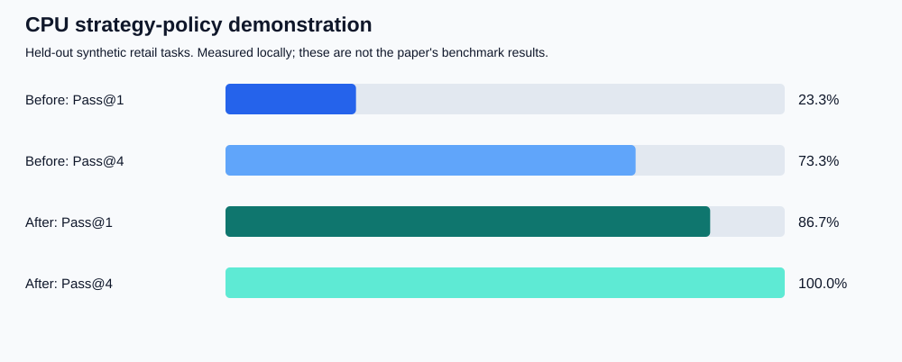
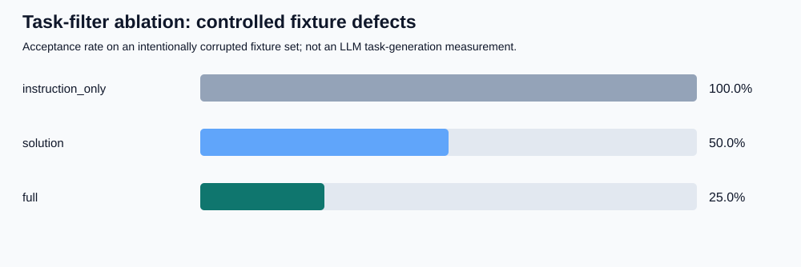

# Measured CPU demonstration

These are results from the repository's **categorical policy over five scripted tool-use strategies**, not an LLM. They are not the source paper's benchmark numbers.

Reproduce with:

```bash
python -m sca demo --seed 42 --train-tasks 120 --test-tasks 60 --rollouts 4 --eval-k 4 --output outputs/cpu_reference
```

See `config.json` for the command configuration and `summary.json`/`metrics.csv` for measured metrics. Elapsed time varies by machine. `sample_task.json` and `sample_before_rollout.json` show one complete task and one baseline attempt. The charts were generated by the code from these measured metrics.

The filter ablation intentionally injects known defects into fixtures. Its acceptance/probe rates apply to that constructed dataset, not to real LLM-generated tasks. Raw full-run conversations remain under the ignored output directory and can be regenerated with the command above.




